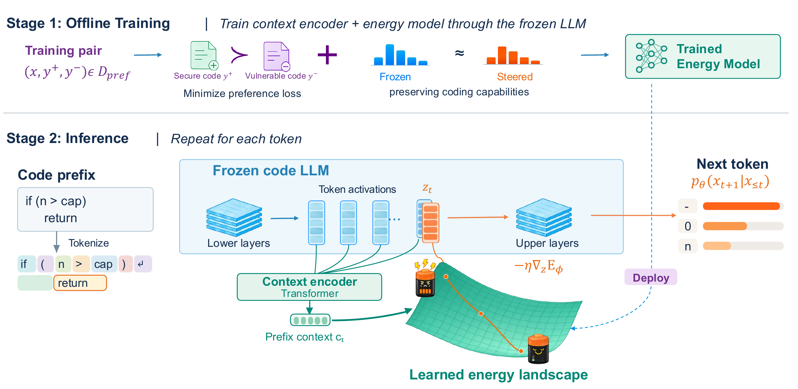

# DisCharge: Context-Dependent Energy-Based Steering for Secure Code Generation

DisCharge makes a frozen code LLM generate more secure code without changing its weights. A small energy model
(about 2–6M parameters) reads the model's activations at one decoder layer and, for every generated token, moves
the activation a few gradient steps downhill on a learned, context-dependent energy landscape. The energy model is
trained on vulnerable/patched function pairs from CVEfixes with a preference objective that keeps the steered model
close to the original, so security improves while functionality is preserved.



This repository reproduces the **Baseline** and **DisCharge** rows of the paper's main results (CodeGuard+, Table 1)
and lets you train DisCharge at any steering layer.

## Contents

```
configs/                    energy model, training and per-model settings
prepare_cvefixes.py         CVEfixes database -> vulnerable/patched function pairs
build_cvefixes.py           function pairs -> tokenized training data for one model
train.py                    trains DisCharge
energy.py, steering.py      energy model and activation steering
codeguard_eval.sh           CodeGuard+ generation and scoring
codeguard_ebt.py            CodeGuard+ generation with DisCharge
codeguard_score.py          CodeGuard+ scoring
scripts/                    CodeGuard+ and CodeQL setup
```

## Models

| Model | Hugging Face name | Config | Steering layer |
|---|---|---|---|
| CodeLlama-13B | `codellama/CodeLlama-13b-hf` | `codellama-13b` | 30 of 40 |
| Qwen2.5-Coder-14B | `Qwen/Qwen2.5-Coder-14B` | `qwen2.5-coder-14b` | 36 of 48 |
| StarCoder2-15B | `bigcode/starcoder2-15b` | `starcoder2-15b` | 30 of 40 |
| DeepSeek-Coder-V2-Lite | `deepseek-ai/DeepSeek-Coder-V2-Lite-Base` | `deepseek-coder-v2-lite` | 20 of 27 |

The configs are in `configs/models/<config>.json`. The steering layer is the zero-based decoder block whose input is
edited, at about 75% of the model's depth.


## Setup

```bash
# training and generation environment
conda create -n discharge python=3.11 -y
conda activate discharge
pip install -r requirements.txt

# CodeGuard+ (at the commit used in the paper) and CodeQL 2.17.5 in ~/codeql
bash scripts/setup_codeguardplus.sh

# CodeGuard+ scoring environment (torch is only imported there, so the CPU build is enough)
conda create -n codeguardplus python=3.10 -y
conda activate codeguardplus
pip install torch==2.14.1 --index-url https://download.pytorch.org/whl/cpu
pip install -r requirements-codeguardplus.txt
conda activate discharge
```

## Reproducing the results

The commands below use CodeLlama-13B at its default layer; see
[Changing the model and layer](#changing-the-model-and-layer) for the others.

### 1. Data

Download [CVEfixes v1.0.8](https://zenodo.org/records/13118970) and load it into SQLite (about 50 GB):

```bash
mkdir -p data/raw && cd data/raw
wget -O CVEfixes_v1.0.8.zip "https://zenodo.org/records/13118970/files/CVEfixes_v1.0.8.zip?download=1"
unzip CVEfixes_v1.0.8.zip
zcat "$(find . -name '*.sql.gz' | head -1)" | sqlite3 CVEfixes.db
cd ../..
```

Extract the vulnerable/patched function pairs, split by repository into train/validation/test (70/15/15). This is
done once for all models:

```bash
python prepare_cvefixes.py --db data/raw/CVEfixes.db --out-dir data/cvefixes
```

Tokenize the pairs for each model. Only C, C++ and Python pairs are kept, the languages CodeGuard+ covers:

```bash
python build_cvefixes.py --csv-dir data/cvefixes --model-name codellama/CodeLlama-13b-hf --output data/codellama-13b.pt
```

### 2. Train

```bash
python train.py --config configs/energy.json configs/training.json configs/models/codellama-13b.json
```

The configs hold the paper's settings; command-line arguments override them. Training takes about 5 h on one H100.
The run writes to `runs/codellama-13b/`: `best.pt` is the checkpoint used for evaluation, and `train.jsonl` has the
training and validation metrics.

### 3. Evaluate on CodeGuard+

Generate 10 samples for each of CodeGuard+'s 103 scenarios and score them, first for the unsteered baseline, then for
DisCharge, and compare the two:

```bash
bash codeguard_eval.sh --baseline codellama/CodeLlama-13b-hf baseline_codellama-13b
bash codeguard_eval.sh runs/codellama-13b/best.pt discharge_codellama-13b
conda run -n codeguardplus python codeguard_score.py discharge_codellama-13b --base baseline_codellama-13b
```

Generation uses CodeGuard+'s own prompts and sampling settings. To run it on several GPUs, prefix the command with
e.g. `GPUS="0 1"`. The generated programs are in `third_party/CodeGuardPlus/experiments/<name>/`, and the scores in
`third_party/CodeGuardPlus/results_<name>.csv` and `summary_<name>.json`.

## Changing the model and layer

**Model.** Pick a row from the [Models](#models) table and use its Hugging Face name and config in every step. For
example, for Qwen2.5-Coder-14B at its default layer:

```bash
python build_cvefixes.py --csv-dir data/cvefixes --model-name Qwen/Qwen2.5-Coder-14B --output data/qwen2.5-coder-14b.pt
python train.py --config configs/energy.json configs/training.json configs/models/qwen2.5-coder-14b.json
bash codeguard_eval.sh --baseline Qwen/Qwen2.5-Coder-14B baseline_qwen2.5-coder-14b
bash codeguard_eval.sh runs/qwen2.5-coder-14b/best.pt discharge_qwen2.5-coder-14b
conda run -n codeguardplus python codeguard_score.py discharge_qwen2.5-coder-14b --base baseline_qwen2.5-coder-14b
```

The data download and `prepare_cvefixes.py` are shared by all models and only need to run once.

**Layer.** Add `--target-layer N` and a new `--output-dir` to the training command, then evaluate that run's
checkpoint. The layer is stored in the checkpoint, so evaluation needs no extra flag, and the baseline does not
depend on the layer. For example, Qwen2.5-Coder-14B steered at layer 30:

```bash
python train.py --config configs/energy.json configs/training.json configs/models/qwen2.5-coder-14b.json \
  --target-layer 30 --output-dir runs/qwen2.5-coder-14b_L30
bash codeguard_eval.sh runs/qwen2.5-coder-14b_L30/best.pt discharge_qwen2.5-coder-14b_L30
conda run -n codeguardplus python codeguard_score.py discharge_qwen2.5-coder-14b_L30 --base baseline_qwen2.5-coder-14b
```
